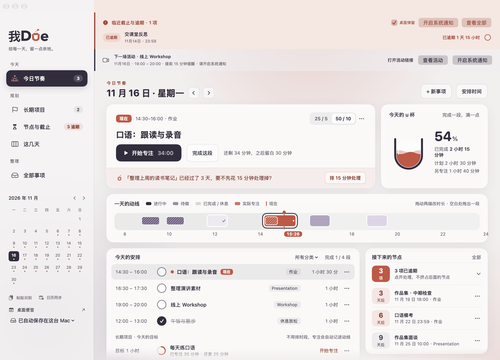
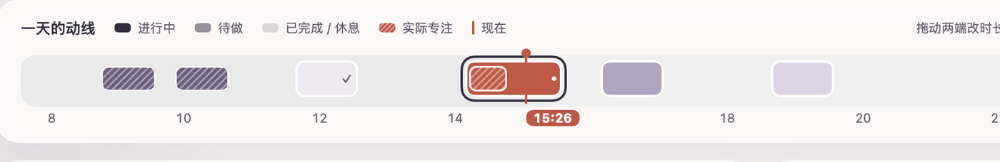
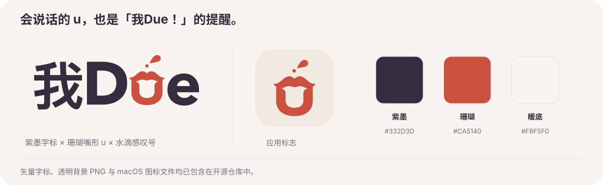

# 我Due！ · WoDue


**给每一天，留一点余地。** A quiet macOS desktop planner that gets louder as deadlines approach.

[下载 v0.6.0（Apple Silicon）](https://github.com/Amalia6767/wodue/releases/download/v0.6.0/wodue-macos-arm64.zip) · [版本说明与校验文件](https://github.com/Amalia6767/wodue/releases/tag/v0.6.0) · [从源码构建](#build-and-run) · [功能总览](docs/功能总览.md) · [中文使用说明](docs/使用说明.md) · [MIT License](LICENSE)

**v0.6.0：从任何入口开始的专注都会自动画进一天的动线并计入 u 杯；动线可以直接拖动改时长；事项、时间块和长期项目都能删除并撤销。** 下载解压后，将「我Due！.app」放入 Applications。适用于 Apple Silicon Mac、macOS 14 及以上；此公开预览版尚未 Apple 公证。更新记录见 [Changelog](CHANGELOG.md)。

我Due！为课程作业、邮件通知、Presentation 和个人活动交织的生活而做：把未来节点落实为今天的时间安排，再用专注与休息一段段推进。

平时，桌面便签几乎没有底色；鼠标移入，底板和操作浮现。临近截止时，提醒逐级变明显；会议和活动提前 15 分钟提醒，卡片里可直接打开已保存的链接。

## 今日工作台



*v0.6.0 实际界面截图，日程均为虚构的演示数据。*

- **专注过的时间，自动出现在动线上**：不论从长期项目卡片、工作台还是菜单开始专注，都按真实的开始和结束时间画成斜纹小段；颜色跟随长期项目，正在进行的会实时变长。
- **u 杯 = 排好的时段 + 实际专注**：没排计划的专注同时计入计划和完成，杯子下方分别显示「计划」和「另专注」。
- **动线可以直接拖**：拖动一段的两端改时长，拖中间平移，在空白处拖出一段新的时间；右键可编辑或删除。
- **长期项目的每日目标**：设了每天投入、但不固定时段的项目，会在今日安排里显示「已专注 / 还差多少」和开始专注按钮。
- **删除都能撤销**：事项、时间块、节点和长期项目都可删除，12 秒内可撤销；删除长期项目时，已专注的时间保留在历史里，只是不再计入该项目。
- **逾期不再挤占节点**：两项以上逾期折叠成一行，点开处理，后面的节点照常显示。



## Logo 与品牌



u 既是字母，也是正在发音的嘴；上方的珊瑚水滴延续了感叹号的形态。应用使用紫墨 `#332D3D`、珊瑚 `#CA5140` 与暖底 `#F8F5F0`。

[字标 SVG](Resources/Brand/WoDueWordmark.svg) · [独立标志 SVG](Resources/Brand/WoDueSymbol.svg) · [透明字标 PNG](Resources/Brand/WoDueWordmarkTrim.png) · [透明标志 PNG](Resources/Brand/WoDueSymbol.png) · [macOS 图标 ICNS](Resources/Brand/AppIcon.icns)

## What it does

| Feature | Behavior |
| --- | --- |
| Quiet desktop note | Transparent at rest; readable text, hover controls, pinning, inline add and compact project progress. Unfinished items come first; completed text stays visible with a strikethrough. |
| Daily rhythm | A daily workbench with activity/focus controls, a u-cup, upcoming milestones and a single-row ribbon. Overlapping events have distinct opaque tones and inset outlines; dark hover cards show times, duration, status and the full wrapping title. Drag a segment's edges to resize it, its middle to move it, or drag across empty time to create one; right-click to edit or delete. Unfinished blocks come first in the checklist; two or more overdue milestones fold into one expandable row. |
| Real focus on the timeline | Every focus round, whichever screen started it, is drawn on the ribbon at its recorded active times as a hatched span in the project's colour. The u-cup counts planned slots plus real focus, so unplanned focus still fills it. |
| Ongoing projects | Custom goals and target dates, recurring daily effort, weekday rules, date-specific exceptions and total-time previews. Project-linked focus accumulates actual active time; optional outcomes and multiple milestones stay separate. Projects can take one of six coral/purple-ink tones; flexible daily targets appear in today's list with time done and time left. |
| Project reminders | A persistent countdown and configurable daily reminders from the project start, or a chosen lead time. The nearest three reminders are queued and replenished while running or on reopening. |
| Long-term plans | Submission deadlines, presentations, workshops, exhibitions and multi-day travel; editable categories and colors. |
| Deadline radar | Highlights the next 72 hours, then escalates on the day, in the last two hours, in the last 30 minutes and when overdue. Date-only items stay date-only. |
| Desktop reminders | Grouped cards, acknowledgment, 30-minute snooze and completion. A snooze never hides an exact deadline past its cutoff. |
| Meeting alerts | Timed activities warn 15 minutes before their start and again at the start. Cards and notification actions open saved meeting links; five-minute snoozes stop at the start time. |
| Focus and breaks | 25/5, 50/10 or custom rounds; pause/resume, a menu-bar timer and a hard stop at the end of a planned block. |
| Mac Calendar | Read-only mirroring of selected calendars through EventKit. Local completion never changes source events. Imported items can be edited locally, with per-field corrections protected from later sync and an option to restore the latest calendar version. |
| Paste to import | Local parsing of email/event text and Canvas assignments/notices, with an editable preview before saving. |
| Deadline updates | Canvas publication time decides which notification wins, including when a newer notice moves a deadline earlier. |
| Month overview | “这几天” switches between a month grid and a four-day focus; click a date to open its full schedule. |
| Delete and undo | Tasks, blocks, milestones and projects can be deleted from editors, row menus and the ribbon, with a 12-second undo. Deleting a project keeps its focus history but stops counting it toward that project. Calendar-mirrored events are deleted in Calendar instead. |
| Local data | JSON persistence, import/export, and separate focus/reminder state. No app-owned cloud service. |

Completing a preparation block does **not** mark its assignment submitted. You decide when the underlying deadline is complete. Reaching an effort estimate does not automatically finish a project or count as an outcome. Pauses, breaks and offline time are excluded from new focus records; active time is allocated across calendar days. Older focus records without recorded start/end times still count toward totals but are not drawn on the ribbon.

## Build and run

Requires **macOS 14+**, Apple Command Line Tools or Xcode, and an Apple Silicon Mac for the default build. The interface is currently in Chinese.

```sh
xcode-select --install  # if Command Line Tools are not installed
git clone https://github.com/Amalia6767/wodue.git
cd wodue
zsh scripts/build.sh
open 'dist/我Due！.app'
```

The build uses SwiftUI, AppKit, EventKit and UserNotifications, with no third-party app dependencies. The local build is ad-hoc signed; this repository does not ship an Apple-notarized installer. An Intel build can be requested with `WODUE_ARCH=x86_64 zsh scripts/build.sh`; that target is not yet runtime-tested here.

First launch starts empty. Add your own plans or try the fictional examples in `examples/`. Real calendars are read only after you connect and choose them. Notifications require your macOS permission.

To try a separate demonstration with fictional tasks:

```sh
zsh scripts/demo.sh
```

The demo uses a separate app identity and data directory and disables calendar access.

## Verify

```sh
python3 scripts/privacy_check.py
zsh scripts/test.sh
zsh scripts/build.sh
```

Tests use isolated temporary documents under `.build/` and a fixed fixture timezone. They do not read your calendar, clipboard, email or normal app data.

## Current limits

- Email and Canvas imports are **explicit paste → preview → save**. The app does not read an inbox, monitor the clipboard or log into Canvas.
- Parsing is local and format-based. Ambiguous or incomplete dates need review. Ordinary announcements are not automatically tasks.
- Calendar subscription updates first need to reach macOS Calendar. The app checks for local calendar changes while running.
- Desktop cards and calendar mirroring need the app running. Already scheduled system notifications can arrive after quitting; delivery follows macOS notification and Focus settings.
- Plans are suggested and timeboxed by you. There is no automatic full-day replanning, mobile app, app-owned cross-device sync or collaboration yet.

## Data and privacy

Normal data lives in:

```text
~/Library/Application Support/io.github.amalia6767.wodue/
```

`tasks.json` stores tasks/projects/categories/blocks (schema 4; projects may carry an optional colour); `focus-v2.json` stores project-aware focus state and history, with the original `focus.json` retained during migration; `deadline-reminders.json` stores deadline acknowledgments and snoozes; `event-reminders.json` stores meeting acknowledgments and snoozes. Paste drafts are also local. Back up this directory to preserve everything. JSON plan exports contain tasks, projects, categories and blocks, but not the separate focus/reminder files.

This public source tree contains fictional examples only. Personal calendars, task exports, imported text, meeting links and local build artifacts are excluded. See [PRIVACY.md](docs/PRIVACY.md) before sharing logs or screenshots.

## Source layout

```text
Sources/       SwiftUI views, persistence, parsers, calendar, focus and reminders
Resources/     App metadata
Tests/         Isolated model/parser/scheduling checks
scripts/       Build, tests, demo and privacy checks
examples/      Fictional import examples
docs/          Usage and privacy notes
```

## Contributing

Small, focused changes and reproducible bug reports are welcome. Describe the behavior, include a fictional example, and run the checks above. Keep generated app bundles and private task data out of commits. See [CONTRIBUTING.md](CONTRIBUTING.md).

## License

[MIT](LICENSE). Copyright © 2026 [Amalia6767](https://github.com/Amalia6767).
