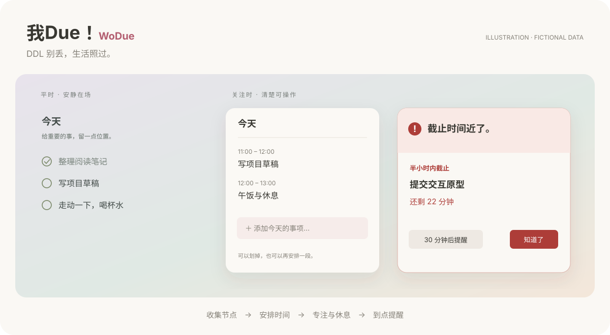

# 我Due！ · WoDue

**DDL 别丢，生活照过。** · Public preview 0.2.0

A quiet macOS desktop planner that gets louder as deadlines approach.



[下载 macOS 版（Apple Silicon）](https://github.com/Amalia6767/wodue/releases/tag/v0.2.0) · [中文使用说明](docs/使用说明.md) · [Privacy](docs/PRIVACY.md) · [MIT License](LICENSE)

我Due！为课程作业、邮件通知、Presentation 和个人活动交织的生活而做：把未来节点落实为今天的时间安排，再用专注与休息一段段推进。

平时，桌面便签几乎没有底色；鼠标移入，底板和操作浮现。临近截止时，提醒逐级变明显；会议和活动提前 15 分钟提醒，卡片里可直接打开已保存的链接。

## What it does

| Feature | Behavior |
| --- | --- |
| Quiet desktop note | Transparent at rest; readable text, hover controls, pinning and inline add. Completed text stays visible with a strikethrough. |
| Daily rhythm | Time blocks with start/end times, linked preparation, overlap warnings and space for breaks. |
| Long-term plans | Submission deadlines, presentations, workshops, exhibitions and multi-day travel; editable categories and colors. |
| Deadline radar | Highlights the next 72 hours, then escalates on the day, in the last two hours, in the last 30 minutes and when overdue. Date-only items stay date-only. |
| Desktop reminders | Grouped cards, acknowledgment, 30-minute snooze and completion. A snooze never hides an exact deadline past its cutoff. |
| Meeting alerts | Timed activities warn 15 minutes before their start and again at the start. Cards and notification actions open saved meeting links; five-minute snoozes stop at the start time. |
| Focus and breaks | 25/5, 50/10 or custom rounds; pause/resume, a menu-bar timer and a hard stop at the end of a planned block. |
| Mac Calendar | Read-only mirroring of selected calendars through EventKit. Local completion never changes source events. |
| Paste to import | Local parsing of email/event text and Canvas assignments/notices, with an editable preview before saving. |
| Deadline updates | Canvas publication time decides which notification wins, including when a newer notice moves a deadline earlier. |
| Local data | JSON persistence, import/export, and separate focus/reminder state. No app-owned cloud service. |

Completing a preparation block does **not** mark its assignment submitted. You decide when the underlying deadline is complete.

## Build and run

Requires **macOS 14+**, Apple Command Line Tools or Xcode, and an Apple Silicon Mac for the default build. The interface is currently in Chinese.

```sh
xcode-select --install  # if Command Line Tools are not installed
git clone https://github.com/Amalia6767/wodue.git
cd wodue
zsh scripts/build.sh
open 'dist/我Due！.app'
```

The build uses SwiftUI, AppKit, EventKit and UserNotifications, with no third-party app dependencies. The local build is ad-hoc signed; this repository does not ship an Apple-notarized installer. An Intel build can be requested with `WODUE_ARCH=x86_64 zsh scripts/build.sh`; that target is not yet runtime-tested here.

First launch starts empty. Add your own plans or try the fictional examples in `examples/`. Real calendars are read only after you connect and choose them. Notifications require your macOS permission.

To try a separate demonstration with fictional tasks:

```sh
zsh scripts/demo.sh
```

The demo uses a separate app identity and data directory and disables calendar access.

## Verify

```sh
python3 scripts/privacy_check.py
zsh scripts/test.sh
zsh scripts/build.sh
```

Tests use isolated temporary documents under `.build/` and a fixed fixture timezone. They do not read your calendar, clipboard, email or normal app data.

## Current limits

- Email and Canvas imports are **explicit paste → preview → save**. The app does not read an inbox, monitor the clipboard or log into Canvas.
- Parsing is local and format-based. Ambiguous or incomplete dates need review. Ordinary announcements are not automatically tasks.
- Calendar subscription updates first need to reach macOS Calendar. The app checks for local calendar changes while running.
- Desktop cards and calendar mirroring need the app running. Already scheduled system notifications can arrive after quitting; delivery follows macOS notification and Focus settings.
- Plans are suggested and timeboxed by you. There is no automatic full-day replanning, mobile app, app-owned cross-device sync or collaboration yet.

## Data and privacy

Normal data lives in:

```text
~/Library/Application Support/io.github.amalia6767.wodue/
```

`tasks.json` stores plans/categories/blocks; `focus.json` stores focus state; `deadline-reminders.json` stores deadline acknowledgments and snoozes; `event-reminders.json` stores meeting acknowledgments and snoozes. Paste drafts are also local. Back up this directory to preserve everything. JSON plan exports contain tasks, categories and blocks, but not the separate focus/reminder files.

This public source tree contains fictional examples only. Personal calendars, task exports, imported text, meeting links and local build artifacts are excluded. See [PRIVACY.md](docs/PRIVACY.md) before sharing logs or screenshots.

## Source layout

```text
Sources/       SwiftUI views, persistence, parsers, calendar, focus and reminders
Resources/     App metadata
Tests/         Isolated model/parser/scheduling checks
scripts/       Build, tests, demo and privacy checks
examples/      Fictional import examples
docs/          Usage and privacy notes
```

## Contributing

Small, focused changes and reproducible bug reports are welcome. Describe the behavior, include a fictional example, and run the checks above. Keep generated app bundles and private task data out of commits. See [CONTRIBUTING.md](CONTRIBUTING.md).

## License

[MIT](LICENSE). Copyright © 2026 [Amalia6767](https://github.com/Amalia6767).
